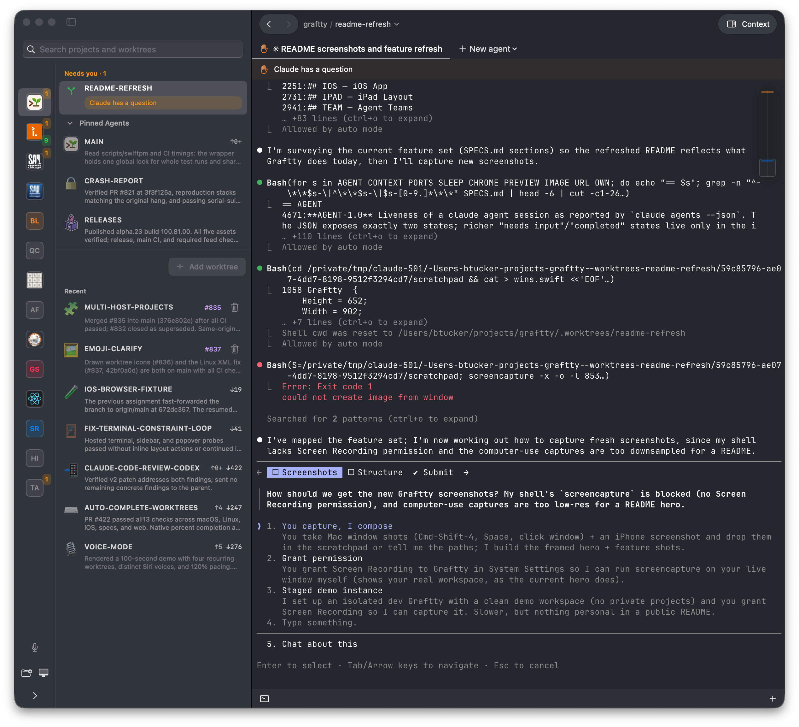
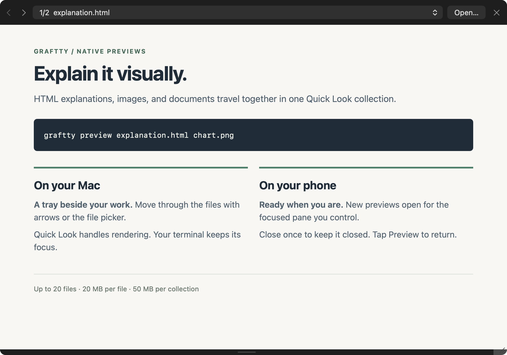
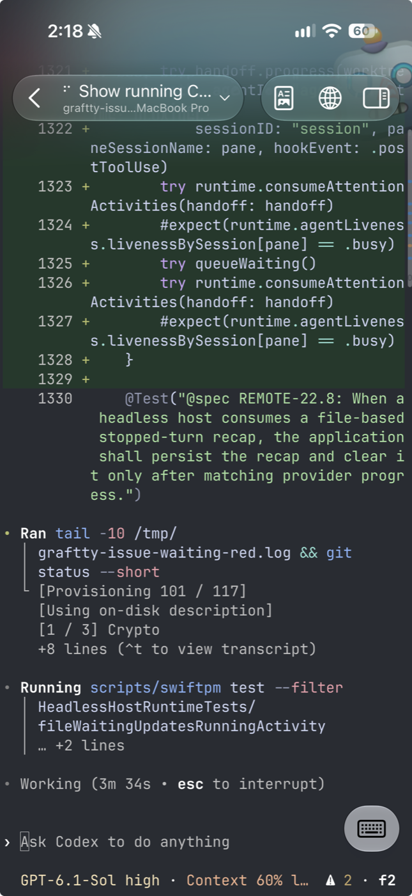

<p align="center">
  
</p>

# Graftty

A worktree-native terminal for running many coding agents at once, built on [libghostty](https://ghostty.org) and [zmx](https://zmx.sh/).

Graftty organizes persistent terminal sessions by Git worktree. Every project and worktree gets its own split layout of terminals, and those terminals keep running when you switch away, quit the app, or pick the work up from your phone. Graftty also tracks what each agent is doing, so the sidebar shows which ones need you.

<p align="center">
  
</p>

## Core features

### Worktrees first

- **One sidebar for every project.** A project rail on the left; each project's worktrees are grouped into **Needs you**, **Pinned Agents**, **Working**, and **Recent**.
- **Terminals that survive.** Every pane is backed by a [zmx](https://zmx.sh/) session, so shells, servers, and agents keep running across worktree switches and app restarts.
- **Splits per worktree.** Each worktree remembers its own split layout. Graftty uses libghostty for the terminal itself, so rendering, fonts, and input behave like Ghostty.
- **Git status at a glance.** Rows show the linked PR or MR (`#123` for GitHub, `!123` for GitLab) and its CI status, plus how far the branch is ahead of or behind the default branch. Ports your panes listen on appear as chips in the header.
- **Create and clean up worktrees** from the sidebar, the CLI, or your phone. Graftty offers to delete worktrees whose PR merged or closed.

### Built for coding agents

- **Claude Code and Codex plugins.** Graftty installs provider plugins that connect agents to the app through hooks and skills. It offers to install them on first launch, and they also live under **Settings → Agent Teams**.
- **Attention that means something.** When an agent asks a question or finishes, its worktree moves to **Needs you** with a badge and an optional desktop notification. Busy agents show as working.
- **Worktree briefs.** Agents keep a short recap of each worktree: what it's for, what's done, decisions made, and what's next. You see it in the sidebar and in the **Context** panel, so you can switch back into a worktree without rereading the transcript.
- **Pinned agents with roles.** Pin long-lived agents (a lead, a release manager, a crash investigator) and give each durable instructions in a `GRAFTTY.md` file.
- **Agent teams.** Agents in one repository can see each other, message each other's inboxes, and react to PR and CI events. One agent can start another in a new worktree with `graftty worktree add <name> --agent claude`.
- **Native previews.** An agent can run `graftty preview explanation.html chart.png` to show HTML, images, and documents in a Quick Look tray beside the terminal. On your phone they open in the pane you control.

<p align="center">
  
</p>

### Take it anywhere



- **iPhone and iPad.** GrafttyMobile pairs with your Mac and attaches to the same live sessions. You can type, take control of a pane's size, answer agents, create worktrees, and view previews. On iPad, panes split side by side.
- **Remote Macs.** Pair two Macs and use one Mac's worktrees and sessions from the other, over the LAN or Tailscale. The connection carries authenticated SSH inside an encrypted WebRTC channel. See [Remote Macs](docs/remote-macs.md).
- **Linux hosts.** Run Graftty's headless host on Ubuntu 24.04 and connect to it from the Mac app. **Set Up Linux Host…** installs it over SSH and imports projects, including committed work that hasn't been pushed. See [Linux hosts](docs/linux-host.md).
- **Web access.** An optional HTTPS web client is served only on your Tailscale addresses.
- **Windows (in progress).** Windows 11 support through WSL2 is under way; see [Windows headless host](docs/windows-host.md).

<br clear="right" />

### Scriptable

The bundled `graftty` CLI lets anything running in a pane drive the app:

```sh
graftty notify "tests passing"                 # badge this worktree in the sidebar
graftty pane add --command "pnpm dev"          # split and run a command
graftty worktree add fix-auth --agent codex    # new worktree with an agent in it
graftty pane show fix-auth:1 --lines 200       # read another worktree's pane
graftty team send --stdin <member>             # message a teammate agent
graftty preview report.html                    # open a native preview
```

See the [CLI reference](docs/cli.md) for everything else.

## Installing

```sh
brew tap btucker/graftty
brew install --cask graftty
```

Installs `Graftty.app` to `/Applications` and symlinks the `graftty` CLI onto `PATH`. On first launch, macOS will block the app with Gatekeeper — approve it under System Settings → Privacy & Security (on Sonoma, right-click → Open). Uninstall with `brew uninstall --cask --zap graftty`.

Graftty updates itself. On first launch, you'll be asked whether
Graftty may check for updates automatically — if you agree, a small
indicator appears in the window titlebar when a new version is
available, and clicking it installs the update. You can also trigger a
check manually from `Graftty → Check for Updates…`.

## Building

Requires Xcode 26 or later to build. Graftty supports macOS 14 Sonoma or later.

```sh
swift build
```

Open `Package.swift` in Xcode to run the app.

Mac and GrafttyMobile builds use the same pinned, published paging renderer.
No native dependency build is required. For renderer development, see the
[explicit local override instructions](scripts/ghostty-paging/BUILD.md).

## Developing the web client

Graftty's browser-facing web access client lives in `web-client/` (React +
Vite + TypeScript + TanStack Router). If you change anything under
`web-client/`, rebuild the bundle that ships with the app:

```bash
./scripts/build-web.sh
```

This refreshes `Sources/GrafttyKit/Web/Resources/{index.html,app.js,app.css}`.
CI verifies the committed bundle matches a fresh build.

You need `node` (LTS) and `pnpm` installed locally for web-client work:

```bash
brew install node pnpm
```

If you only touch Swift, you need neither — the committed bundle is what
`swift build` ships, and Homebrew users get the prebuilt tarball.

## Further reading

- [Agents in Graftty](docs/agents.md): pinned agents, `GRAFTTY.md` instruction files, and agent teams.
- [The graftty CLI](docs/cli.md): every command, with examples.
- [Remote Macs](docs/remote-macs.md): pairing, reconnection, and the trust model.
- [Linux hosts](docs/linux-host.md) and [Windows hosts](docs/windows-host.md).
- [`SPECS.md`](SPECS.md): the authoritative EARS-style behavior spec.
- [`docs/`](docs): design notes and architecture details.

## License

MIT — see [`LICENSE`](LICENSE).
