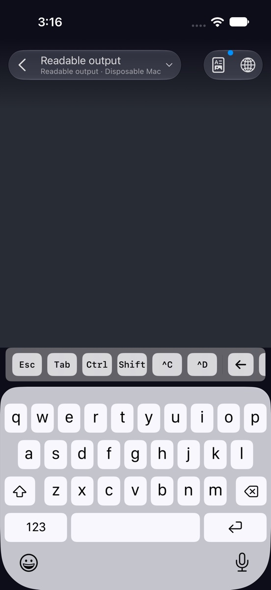
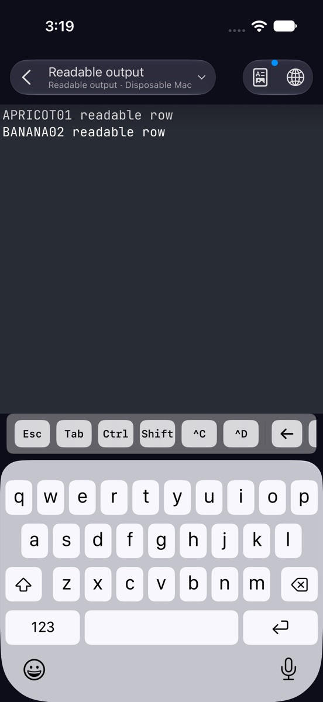
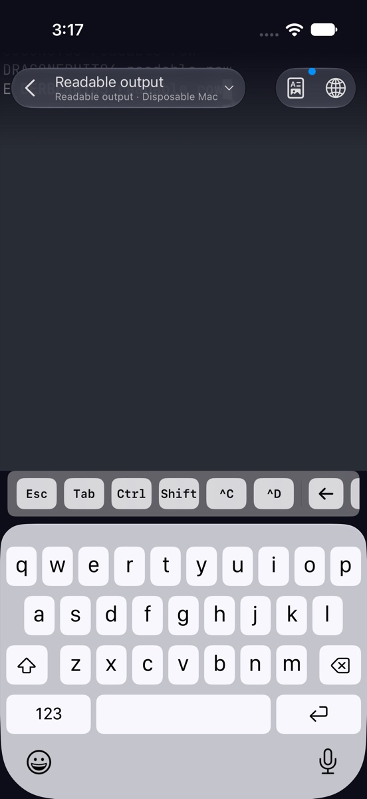
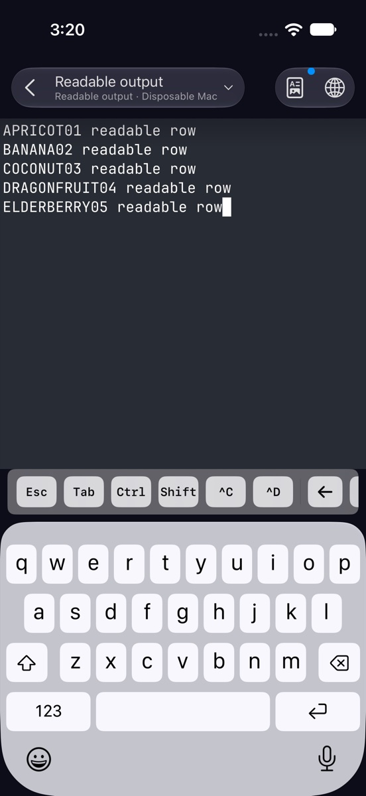
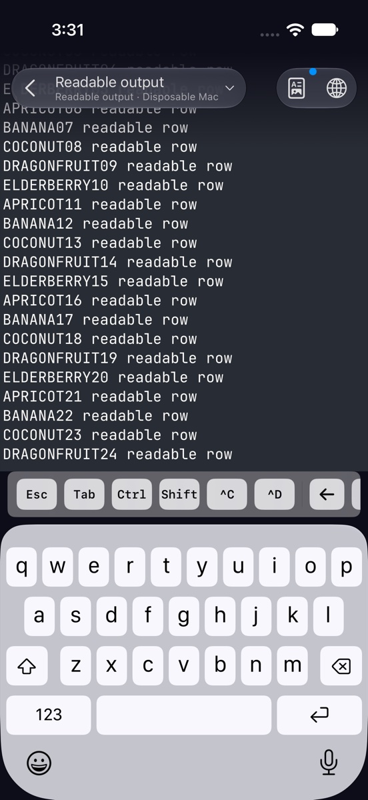
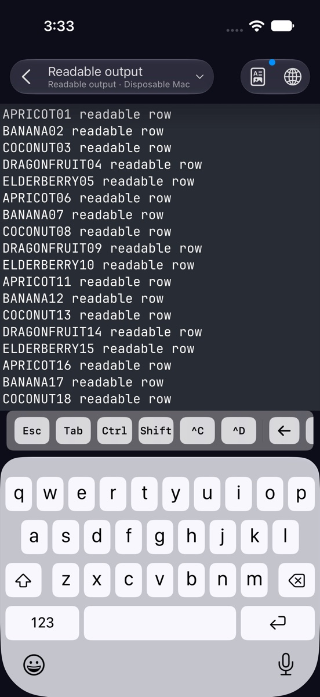

# iPhone terminal readability replay, November 22, 2026

The fullscreen viewport now starts below the floating header. Terminal output no longer removes that clearance when a second line arrives. The background still reaches the screen edges. Embedded iPad panes and compact Terminal sheets keep their existing bounds.

The baseline was `0656cba7f8127b4c53386a111896dc7f16a73e18`, the build used in the polish pilot. Its layout source was restored for the baseline replay, with source hashes recorded and the candidate restored afterward.

## Device and scope

The replay used a disposable iPhone 17 Pro Simulator on iOS 27.0. A paired iPhone 15 Pro was connected with Developer Mode enabled, but Xcode could not launch the test while it was locked. The hardware check remains pending.

`TerminalReadabilityFixture` mounts production `SingleSessionView`, its retained terminal, floating controls, software keyboard, scrolling, resource download, and native Quick Look. A synthetic socket supplies ownership snapshots and named output. The preview uses controlled file I/O. This checks the native interface and renderer, not a physical-device connection or remote shell delivery.

Each run opened the keyboard, displayed two rows, five rows, an initial terminal grid's worth of rows, and 40 rows with scrollback. Words such as `APRICOT01`, `BANANA02`, and `COCONUT03` appeared at the start of rows. XCUITest dragged down and up, opened and dismissed Preview, restored keyboard focus by tapping the terminal when needed, and repeated scrolling. The replay requires the keyboard before output checks and again after preview dismissal.

## What was readable

| Output | Baseline | Candidate |
| --- | --- | --- |
| Two rows | Neither complete word was visible. Ordinary scrolling did not recover them. | Both words were visible below the header without scrolling. |
| Five rows | The header and its wash covered the words. Scrolling did not make the complete response readable. | All five words were visible, including after preview dismissal. |
| Initial full grid | The viewport grew when output arrived. The first rows remained behind the header, with empty space appearing below the response. | All 18 rows fit below the header and above the keyboard control bar at the fixture's font size. |
| 40 rows | Scrolling exposed older output, but the header still covered words at the top of each view. | Four downward drags reached the complete first word, `APRICOT01`; reverse drags returned to `ELDERBERRY40`. Overlapping positions revealed all 40 words, including after Preview. |

### Two rows with the keyboard open

| Baseline | Candidate |
| --- | --- |
|  |  |

### Five rows after closing Preview

| Baseline | Candidate |
| --- | --- |
|  |  |

### Oldest scrollback after closing Preview

At the earliest scroll position, the baseline still hid the first words. The candidate exposed `APRICOT01` below the header and returned to row 40 through ordinary reverse scrolling.

| Baseline | Candidate |
| --- | --- |
|  |  |

### Full terminal with the keyboard open

## Validation

The changed viewport assertions failed on the baseline. The named-output cases detected both covered rows and a grid-size change after output arrived.

The candidate's iPhone run passed 77 viewport, terminal-input, and clearance-refresh tests, plus 30 browser and preview tests. The strengthened Unicode cases wait for actual physical wrapping, and the scrollback case waits for loaded history before checking geometry. A separate iPad Pro 11-inch Simulator run passed all 12 viewport tests, including embedded pane bounds and shared keyboard observation.

The complete `scripts/swiftpm test` run failed in unchanged macOS timeout, subprocess, and rendering tests. The changed runtime code is inside `#if canImport(UIKit)` and does not run on macOS. This result is not a full-suite pass.

The required `code-review xhigh --fix` review found two validation gaps: geometry waits could finish before output parsed, and a post-preview capture could omit the keyboard. Both were corrected. The adjacent header-render test now checks terminal gestures below the floating controls.

Local recordings, screenshots, Xcode result bundles, source hashes, and the SwiftPM failure inventory are retained under `.blindspots/experiments/iphone-readability/`.

The replay is selected with scheme `GrafttyBrowserInteraction` and test class `GrafttyMobileInteractionTests/TerminalReadabilityInteractionTests`. Viewport and preview checks use scheme `GrafttyMobile` with `RenderedTerminalViewportTests`, `TerminalPaneViewTests`, `FirstLineClearanceRefreshTests`, and `RemoteBrowserButtonTests`.
